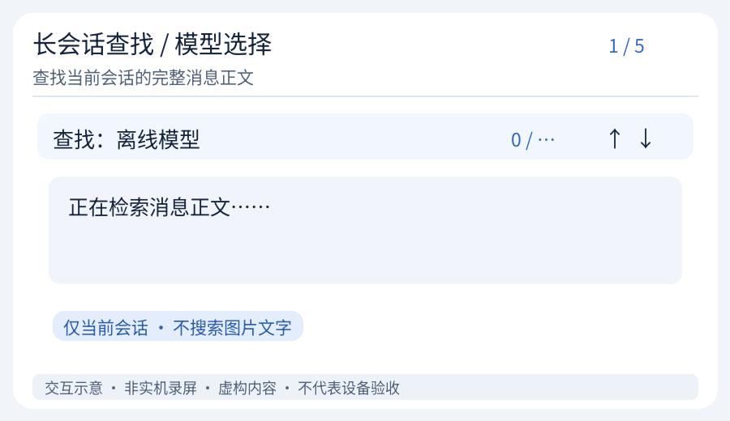
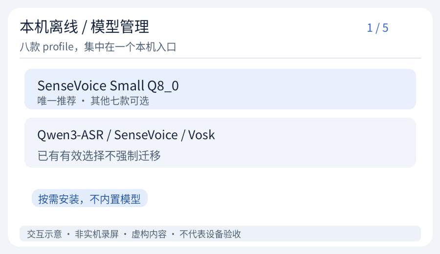
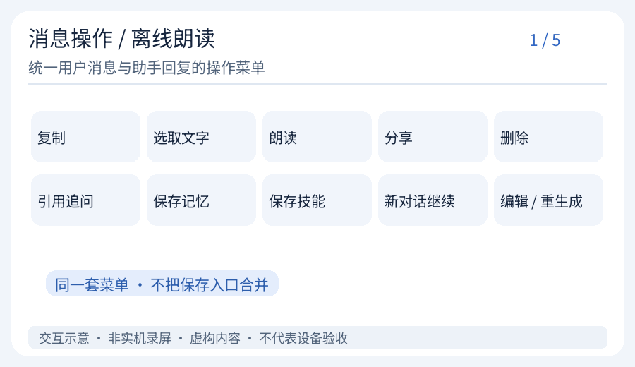
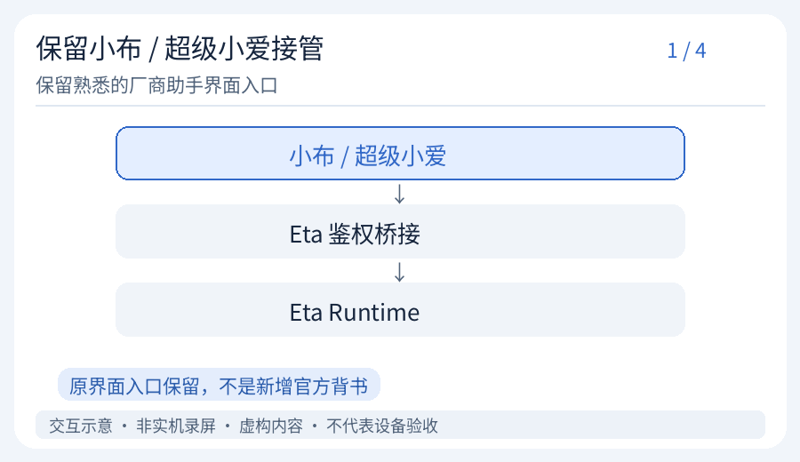

# Eta · Time-IU 定制版

[Mangi-11/Eta](https://github.com/Mangi-11/Eta) 的非官方个人分支，重点改进消息交互、本机语音和长会话查找，不重复介绍上游已有的手机 Agent、终端、记忆、Skills 与 MCP 能力。

[下载安装](https://github.com/Time-IU/Eta/releases/tag/v3.4.4-custom.5) · [更新记录](docs/custom/RELEASE-custom.5.md) · [问题反馈](https://github.com/Time-IU/Eta/issues) · [English](README_EN.md)

## 与同版本上游有什么不同

比较基准：上游 **v3.4.4**；公开定制版 **custom.5** 已同步至上游提交 [`0b70953`](https://github.com/Mangi-11/Eta/commit/0b70953453b173405a4d9dcfad54be78cf3aec70)。以下仅列该快照上的定制差异，不把后续本机测试改动算作已发布功能。

| 方向 | 本分支的改动 |
| --- | --- |
| 长会话查找 | 检索当前会话完整消息正文，逐页加载早期记录；匹配计数、高亮预览、上一处／下一处与原消息定位。不是跨会话搜索或图片 OCR。 |
| 消息操作 | 用户／助手消息使用统一菜单；原位选字、引用保留草稿；手动保存记忆和技能先预览、再确认，不自动发送。 |
| 本机语音 | 单一“本机离线”入口提供 Qwen3-ASR、SenseVoice、Vosk 共八款模型；Q8_0 唯一推荐。支持导入、下载和单独删除权重，不随 APK 内置模型，不静默转云端。 |
| 朗读与停顿 | 消息离线朗读增加暂停续读、进度定位与分句控制；采集侧统一停顿检测。停顿阈值不等于识别耗时。 |
| 模型选择 | 长模型名或大字号放不下时，转入可搜索的选择面板，完整展示名称。 |
| 厂商入口 | 保留并适配小布／超级小爱原界面接管，补充鉴权和取消保护；需要对应 ROM、权限与 Hook 配置，不承诺全机型可用。 |

另按定制范围移除 Kimi Code／Kimi Web 集成和旧 Gemini 系统增强；**普通 Kimi API、普通 Gemini 路由保留**。

## 重点功能动态图

**以下均为原创交互示意 GIF，使用虚构内容，不是实机录屏，也不代表功能已通过设备验收。** 实际布局以安装包为准。

| 长会话查找与模型选择 | 本机离线模型管理 |
| :---: | :---: |
|  |  |

| 消息菜单与离线朗读 | 厂商助手入口保留 |
| :---: | :---: |
|  |  |

## 安装与使用边界

- Android 13+、ARM64；基础使用不要求 Root，厂商入口等增强功能另需对应授权和适配。
- 从[本仓库 Releases](https://github.com/Time-IU/Eta/releases)下载 APK 与校验和。**定制签名与官方不同**，升级前备份；不要为解决签名冲突直接卸载日用版。
- 本机模型按需下载／导入；删除只针对相应私有安装权重与元数据，保留引擎、其他模型及原始 ZIP／GGUF。已有有效模型选择不强制迁移。
- 本机 ASR／离线朗读不等于整个助手离线；模型 API、在线语音仍按配置联网。缺少离线音色时明确提示，不偷偷切云端。
- custom.5 的构建、388 项选定回归、签名与 ART 校验已有记录；5 套环境不兼容测试排除，**不是全项目全测**。厂商桥接、真实语音和双主题界面仍有未完成的实机验收，见[验证摘要](docs/custom/validation-custom.5.json)。

## 文档与归属

- [定制说明](docs/custom/README.md) · [构建](BUILD.md) · [源码路径](docs/custom/MODIFICATIONS.md) · [第三方组件与模型许可](THIRD_PARTY.md)
- 上游基础功能请直接阅读 [Eta 上游文档](https://github.com/Mangi-11/Eta)，这里不复制其完整说明。
- 本分支由 Time-IU 维护，使用 AI 辅助修改；感谢 Mangi-11 及上游、第三方贡献者。主项目保留 [GPL-3.0 许可原文](LICENSE)与版权声明，第三方组件和模型各遵循自身许可。不代表上游认可或背书。

发布状态、重点更新、对应源码及安装包校验和以 [Releases](https://github.com/Time-IU/Eta/releases) 中实际公开的版本为准；未列入 Release 的本机测试构建不代表已公开发布。
