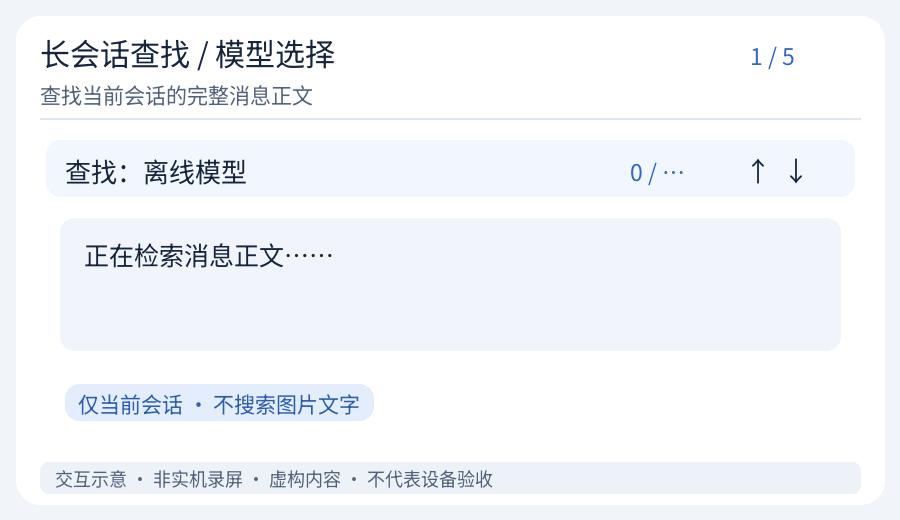
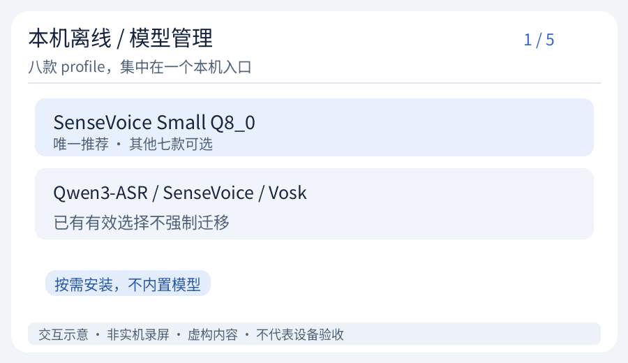
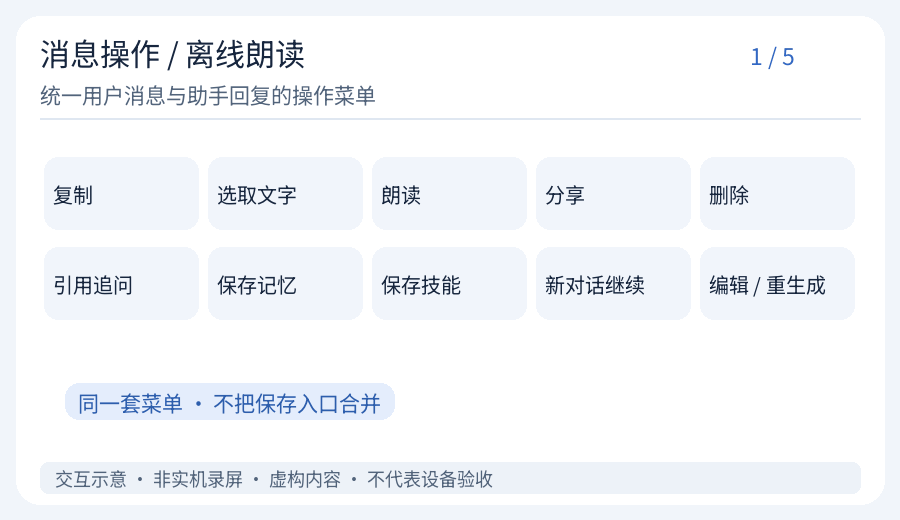
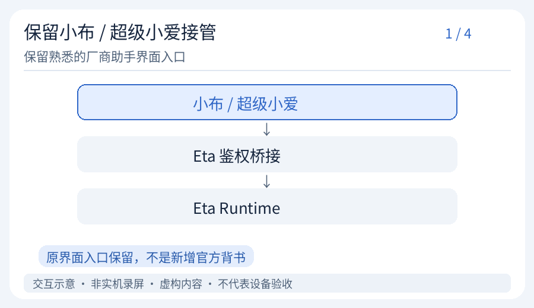

# Eta · Time-IU Custom Fork

An unofficial personal fork of [Mangi-11/Eta](https://github.com/Mangi-11/Eta), focused on message interaction, on-device speech and searching long conversations. Eta's Agent Runtime, terminal, memory, Skills and MCP are upstream capabilities, not original work by this fork.

[Download](https://github.com/Time-IU/Eta/releases/tag/v3.4.4-custom.5) · [Release notes](docs/custom/RELEASE-custom.5.md) · [Issues](https://github.com/Time-IU/Eta/issues) · [简体中文](README.md)

## Differences From the Matching Upstream Version

Baseline: upstream **v3.4.4**, synchronized through [`0b70953`](https://github.com/Mangi-11/Eta/commit/0b70953453b173405a4d9dcfad54be78cf3aec70) in the published **custom.5** preview. The list does not include later unpublished local integration builds.

| Area | Custom changes |
| --- | --- |
| Conversation search | Search the complete current conversation's message text, including paged history; match counts, highlighted previews, previous/next and jump to the original message. Not cross-conversation search or image OCR. |
| Message actions | Shared user/assistant menus, in-place text selection and draft-preserving quotes. Manual memory/skill saving uses editable previews and explicit confirmation. |
| On-device ASR | One local entry for eight Qwen3-ASR, SenseVoice and Vosk profiles. SenseVoice Q8_0 is the sole recommendation. Import/download/delete individual weights; no bundled weights or silent cloud fallback. |
| Speech playback | Offline message playback with pause/resume, seeking and sentence controls; shared capture-side pause detection. The silence threshold is not a recognition latency guarantee. |
| Model picker | Long names or large fonts open a searchable selection sheet rather than being clipped. |
| Vendor assistants | Retain and adapt the Xiaobu / Super XiaoAI interface bridge, including authentication and cancellation protection. Requires supported ROMs, permissions and Hook setup; not universally verified. |

Kimi Code/Web integration and legacy Gemini system enhancements are removed; ordinary Kimi API and Gemini routing remain.

## Animated Feature Guides

**All GIFs below are original interaction diagrams with fictional content—not device recordings or acceptance-test evidence. Actual UI may differ.** Chinese labels correspond to the Chinese interface.

| Conversation search and model picker | Offline model management |
| :---: | :---: |
|  |  |

| Message actions and offline playback | Retained vendor assistant bridge |
| :---: | :---: |
|  |  |

## Installation and Limits

- Android 13+, ARM64. Basic use does not require Root; vendor integration requires additional permissions and device support.
- Use [this fork's Releases](https://github.com/Time-IU/Eta/releases) and checksums. **Custom and official signing certificates differ.** Back up first; do not uninstall your daily app merely to bypass a signature conflict.
- Model weights are installed on demand. Deletion preserves the engine, other models and original ZIP/GGUF imports. Existing valid selections are not forcibly migrated.
- Local ASR/playback does not make the entire assistant offline. Model APIs and online speech still use their configured services; unavailable offline voices produce an explicit error.
- custom.5 has recorded build, 388 selected regression tests, signature and ART checks. Five environment-incompatible suites were excluded; this is **not a full-project test pass**. Vendor-device, real-speech and two-theme UI acceptance remain incomplete; see the [validation summary](docs/custom/validation-custom.5.json).

## Documentation and Credits

[Custom documentation](docs/custom/README.md) · [Build](BUILD.md) · [Source map](docs/custom/MODIFICATIONS.md) · [Third-party licenses](THIRD_PARTY.md)

Read the [upstream documentation](https://github.com/Mangi-11/Eta) for shared functionality. This README's difference-first organization references [Oo0520/Eta-por](https://github.com/Oo0520/Eta-por); that does not mean its code, feature list, license or distribution policy applies to this repository.

Maintained by Time-IU with AI assistance. Thanks to Mangi-11 and upstream/third-party contributors. The existing [GPL-3.0 license text](LICENSE) and copyright notices are retained; components and models have their own licenses. This fork is not endorsed by upstream.

This refresh changes documentation and illustrations only. It does not publish local `integration-por` builds, modify existing Releases/tags, or resolve that integration's outstanding licensing/distribution questions.
