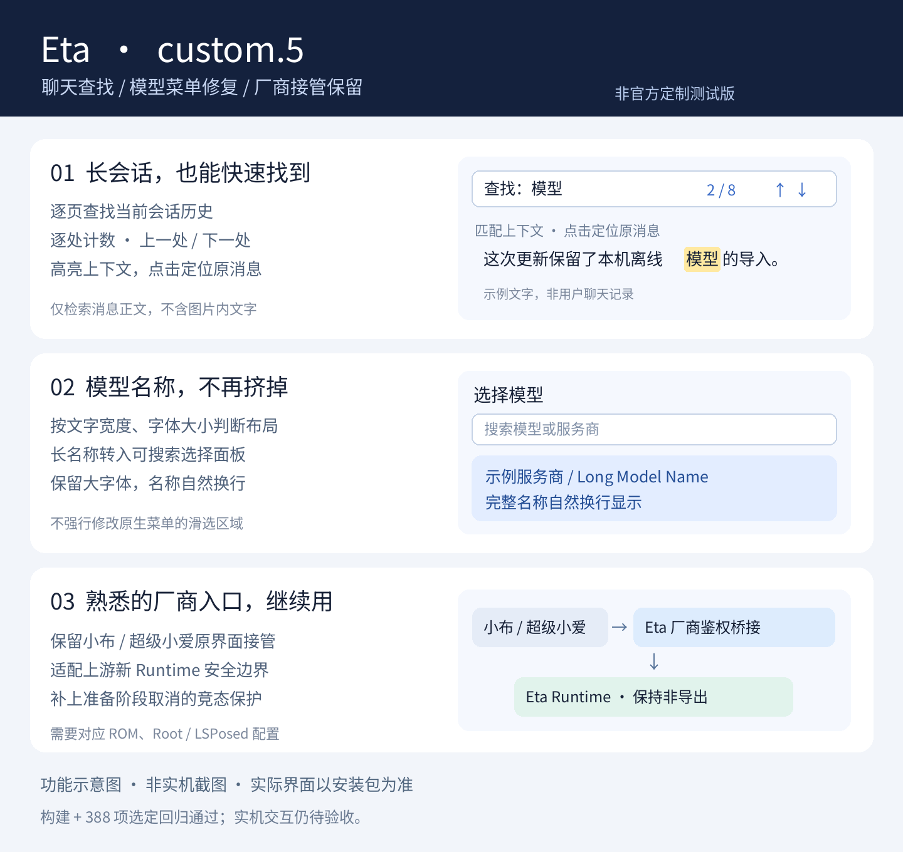

# custom.5 · 聊天查找与显示修复

基于上游 `0b70953` 的非官方定制测试版，保留此前离线语音与模型管理功能。

- **新增查找**：搜索完整当前会话，逐处计数、高亮预览、上下处定位。
- **修复裁切**：模型长名称／大字体放不下时改用完整选择面板。
- **保留接管**：小布／超级小爱适配新版，补齐鉴权及取消保护。
- **同步精简**：按确认移除 Kimi Code／Web 集成与旧 Gemini 系统增强；不移除 Kimi API、普通 Gemini 路由。

**安装**：下载 APK；沿用 custom.4 定制签名，与官方签名不同。升级前备份，勿为签名冲突卸载。

**验证**：构建、388 项选定回归、签名与 ART 校验通过；5 套环境不兼容测试排除，非全测；厂商实机／界面验收尚未完成。

[详细记录](CHANGELOG-custom.5.md) · [验证边界](validation-custom.5.json) · [第三方许可](../../THIRD_PARTY.md)
